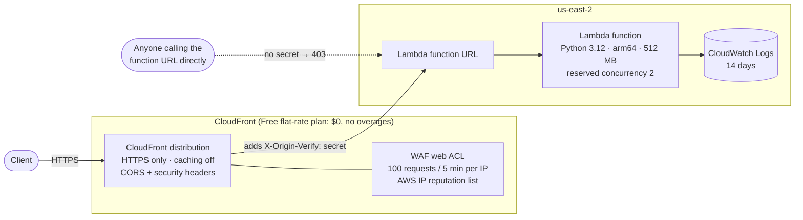

# AWS architecture

The API runs as a single Lambda function behind CloudFront. The goal of the setup is
that **the worst-case cost is bounded by construction**, and that the function can only
be reached through the front door.

## How a request flows



1. **CloudFront** terminates HTTPS at the nearest edge location. Plain HTTP is refused.
2. **WAF** blocks an IP that sends more than 100 requests in 5 minutes, and anything on AWS's IP reputation list. Blocked requests never reach the function.
3. CloudFront forwards the request to the **Lambda function URL**, adding an `X-Origin-Verify` header with a secret. It overwrites any header of that name a client sends.
4. The **app** rejects any request without the right secret (`403`), so calling the function URL directly gets nowhere. It then validates the spec, generates the data, and returns JSON or CSV.

## Resources

| Resource | Stack | Purpose | Cost |
|---|---|---|---|
| CloudFront distribution | `front-door` | public HTTPS entry point | $0 (Free plan) |
| WAF web ACL (2 rules) | `front-door` | rate limiting, bad-IP blocking | $0 (Free plan) |
| CloudFront Free plan subscription | `front-door` | makes the two above flat-rate, with no overages | $0 |
| Lambda function + function URL | `api-function` | runs the API | per use, capped (below) |
| IAM role | `api-function` | lets the function write its own logs, nothing else | free |
| CloudWatch log group | `api-function` | function logs, kept 14 days | pennies |
| Origin secret (`random_password`) | `api-function` | shared between the function and CloudFront | free |

Every resource is tagged with `Repo = amcaughan-personal/data-simulator-api` and its
`Stack` (e.g. `live/prod/front-door`), so anything in the console points back to this code.
The account baseline (CloudTrail, GuardDuty, budgets, the state bucket) lives in
[personal_infra](https://github.com/amcaughan-personal/personal_infra).

## Cost bounds

| Layer | What caps it |
|---|---|
| CloudFront + WAF | Free flat-rate plan: $0 with no overage charges, regardless of traffic. Requests WAF blocks don't count toward the plan's allowance. |
| Lambda | Reserved concurrency of 2: at most two requests run at once, and requests beyond that are throttled (Lambda doesn't bill throttled requests). Each request is bounded by the 100,000-cell response limit and a 10 s timeout. |
| Direct calls to the function URL | Rejected by the app in about a millisecond, and subject to the same concurrency cap. |
| Everything else | The account's monthly budget and cost anomaly alerts (personal_infra). |

Measured on the live setup: a burst of 200 requests from one IP saw 38 throttled by the
concurrency cap (`429`) and the IP blocked by WAF (`403`) about 24 seconds later.

## Infrastructure as code

```
infra/terragrunt/
  root.hcl                      S3 state backend, providers (incl. a us-east-1 alias for WAF), tags
  modules/
    api-function/               Lambda + function URL + log group + least-privilege role
    front-door/cloudfront/      CloudFront + WAF + Free plan subscription
  live/prod/
    api-function/               the function
    front-door/                 the public entry point; reads api-function's outputs
```

The front door is its own stack. Another front door (for example API Gateway) would be
a module under `modules/front-door/` taking the same two inputs (`origin_domain`,
`origin_secret`), with `live/prod/front-door` pointed at it. The function stack wouldn't change.

## Building and deploying

```bash
./scripts/build-lambda.sh                         # dist/lambda.zip
local-dev/dev-shell.sh                            # shell with pinned Terraform and Terragrunt
cd infra/terragrunt/live/prod/api-function && terragrunt apply
cd ../front-door && terragrunt apply              # only when the front door changes
```

`build-lambda.sh` packages the app with its runtime dependencies as Linux arm64 wheels.
The zip is reproducible (sorted entries, fixed timestamps), so Terraform only redeploys
when the code actually changes.

Applies are manual and plan-first. Provider versions are pinned by committed lock files.

## Checking it

```bash
curl https://d1dfbd1pkurhz5.cloudfront.net/health                       # {"status":"ok"}
curl -X OPTIONS -H "Origin: https://example.com" \
     -H "Access-Control-Request-Method: POST" -i \
     https://d1dfbd1pkurhz5.cloudfront.net/v1/datasets                  # 200 + CORS headers
```
