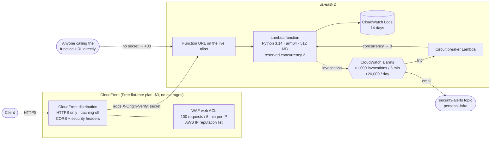
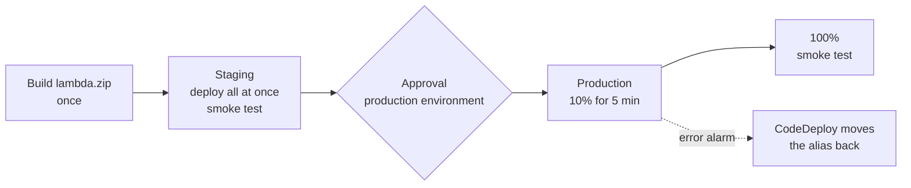

# AWS architecture

The API runs as a Lambda function behind CloudFront, in two identical environments:
**staging** and **production**. The goals of the setup:

- **The worst-case cost is bounded by construction.**
- **The function can only be reached through the front door.**
- **Every merge ships itself safely:** staging first, then a canary in production that
  rolls back on errors.

| | Production | Staging |
|---|---|---|
| URL | https://d1dfbd1pkurhz5.cloudfront.net | https://d3ede7d9l0upni.cloudfront.net |
| Function | `data-simulator-api` | `data-simulator-api-staging` |
| Reserved concurrency | 2 | 1 |
| Circuit breaker | 1,000 / 5 min, 20,000 / day | 200 / 5 min, 2,000 / day |
| New versions | 10% canary for 5 minutes, then all traffic | all at once |

## How a request flows



1. **CloudFront** terminates HTTPS at the nearest edge location. Plain HTTP is refused.
2. **WAF** blocks an IP that sends more than 100 requests in 5 minutes, and anything on AWS's IP reputation list. Blocked requests never reach the function.
3. CloudFront forwards the request to the **function URL of the `live` alias**, adding an `X-Origin-Verify` header with a secret. It overwrites any header of that name a client sends.
4. The **app** rejects any request without the right secret (`403`), so calling the function URL directly gets nowhere. It then validates the spec, generates the data, and returns JSON or CSV.
5. **CloudWatch alarms** watch the function's invocations. Above 1,000 in 5 minutes or 20,000 in a day, the **circuit breaker** sets the function's concurrency to 0, so every request is throttled (`429`) and nothing more is billed. You also get an email.

## Resources

| Resource | Stack | Purpose | Cost |
|---|---|---|---|
| CloudFront distribution | `front-door` | public HTTPS entry point | $0 (Free plan) |
| WAF web ACL (2 rules) | `front-door` | rate limiting, bad-IP blocking | $0 (Free plan) |
| CloudFront Free plan subscription | `front-door` | makes the two above flat-rate, with no overages | $0 |
| SSM parameter `/services/data-simulator-api/<env>/url` | `front-door` | the public URL, for other projects to look up | free |
| Lambda function + function URL | `api-function` | runs the API | per use, capped (below) |
| IAM role | `api-function` | lets the function write its own logs, nothing else | free |
| CloudWatch log group | `api-function` | function logs, kept 14 days | pennies |
| Origin secret (`random_password`) | `api-function` | shared between the function and CloudFront | free |
| 2 CloudWatch alarms | `circuit-breaker` | trip on a burst or a sustained day of heavy use | free tier (10 alarms) |
| Breaker Lambda + role | `circuit-breaker` | sets the API's concurrency to 0; its role can do only that | runs only when tripped |

Every resource is tagged with `Repo = amcaughan-personal/data-simulator-api` and its
`Stack` (e.g. `live/prod/front-door`), so anything in the console points back to this code.
The account baseline (CloudTrail, GuardDuty, budgets, the state bucket) lives in
[personal-infra](https://github.com/amcaughan-personal/personal-infra).

## Cost bounds

| Layer | What caps it |
|---|---|
| CloudFront + WAF | Free flat-rate plan: $0 with no overage charges, regardless of traffic. Requests WAF blocks don't count toward the plan's allowance. |
| Lambda | Reserved concurrency of 2: at most two requests run at once, and requests beyond that are throttled (Lambda doesn't bill throttled requests). Each request is bounded by the 100,000-cell response limit and a 10 s timeout. |
| Direct calls to the function URL | Rejected by the app in about a millisecond, and subject to the same concurrency cap. |
| Sustained heavy use | The circuit breaker stops the function after 1,000 invocations in 5 minutes or 20,000 in a day. At the daily limit, Lambda costs about $0.05 a day. |
| Everything else | The account's monthly budget and cost anomaly alerts (personal-infra). |

In practice, a burst from one IP starts getting `429` from the concurrency cap
straight away, and `403` from WAF within about half a minute. When the circuit breaker
trips, every request gets `429` within seconds. To check the breaker without real
traffic, force its alarm:

```bash
aws cloudwatch set-alarm-state --alarm-name data-simulator-api-staging-circuit-breaker-burst \
  --state-value ALARM --state-reason "Checking the circuit breaker"
```

**Turning the API back on after the breaker trips** is deliberately manual: re-apply the
function stack, which restores its configured concurrency.

```bash
cd infra/terragrunt/live/prod/api-function && terragrunt apply   # plan shows concurrency 0 -> 2 (staging: live/staging)
```

## How code is deployed

Every merge to main runs the [deploy workflow](../.github/workflows/deploy.yml):



- **One package, promoted:** the zip is built once and the same file goes to both environments.
- **Versions and an alias:** each deploy uploads the code, publishes it as an immutable
  numbered version, and asks **CodeDeploy** to move the `live` alias to it. Traffic only
  ever reaches the alias. In production the shift is a canary: 10% of requests for 5
  minutes, then all of them. If the alias's error alarm fires during a deployment,
  CodeDeploy moves it back on its own.
- **Approval:** production jobs wait for a reviewer, enforced by the GitHub `production`
  environment (managed in personal-infra). Turning that off makes it pure CI/CD, with no
  workflow change.
- **No stored AWS keys:** each job signs in through GitHub's OIDC provider as its
  environment's deploy role. A role trusts only jobs in its own environment, so only
  `main`, and in production only after approval, can get credentials. It can upload,
  publish and deploy that one function, and nothing else.
- **Rolling back:** re-run an earlier run of the workflow (or let the alarm do it during
  a canary). Versions are immutable, so the old code is still there.
- **Checking the automatic rollback:** start a CodeDeploy deployment between two existing
  versions, then force the error alarm while the canary is running. CodeDeploy stops the
  deployment and moves all traffic back within seconds:

  ```bash
  aws cloudwatch set-alarm-state --alarm-name data-simulator-api-live-errors \
    --state-value ALARM --state-reason "Checking the canary rollback"
  ```
- **Who owns what:** Terraform owns the function's configuration and creates the alias;
  CI owns the code and which version the alias points to (Terraform ignores both).
  Configuration changes reach traffic with the next deploy, because each published
  version keeps the configuration it was published with.

## Monitoring

| What | How | Cost |
|---|---|---|
| Error alarm (per environment) | Failed invocations plus 5xx responses from the `live` alias (a 500 from the app doesn't fail the invocation, so both count). Triggers the canary rollback during deploys; in production it also emails via the `security-alerts` topic. | about $0.10 a month |
| Scheduled smoke test | A CloudWatch Synthetics canary (`smoke-test` stack, production only) sends the smoke-test requests every day at 09:00 UTC; an alarm emails if a run fails. Run artifacts expire after two weeks. | about $0.10 a month (the alarm; 30 runs a month are within the free 100) |
| Circuit-breaker alarms | email when the breaker trips (see above) | included above |

## Infrastructure as code

```
infra/terragrunt/
  root.hcl                      S3 state backend, providers (incl. a us-east-1 alias for WAF), tags
  modules/
    api-function/               Lambda + function URL + log group + least-privilege role
    front-door/cloudfront/      CloudFront + WAF + Free plan subscription; publishes the URL
    circuit-breaker/            alarms + a Lambda that stops the function when they fire
    deployment/                 CodeDeploy + rollback alarm + the role CI deploys as
    smoke-test/                 a daily Synthetics canary running the smoke tests, and its alarm
    github-variables/           publishes values the deploy workflow needs (see below)
  live/
    prod/
      env.hcl                   everything that differs per environment (names, limits, rollout)
      api-function/             the function and its live alias
      front-door/               the public entry point; reads api-function's outputs
      circuit-breaker/          watches api-function
      deployment/               how code reaches the live alias
      github-variables/         API_URL, DEPLOY_ROLE_ARN, FUNCTION_NAME for GitHub
      smoke-test/               production only
    staging/                    the same stacks, with staging's env.hcl
```

The stack files are identical in both environments; only `env.hcl` differs.

The deploy workflow doesn't hard-code URLs or role ARNs. Each environment's
`github-variables` stack publishes them to SSM Parameter Store at
`/github/data-simulator-api/<environment>/<NAME>`, and personal-infra's GitHub stack turns
those into GitHub environment variables, read in the workflow as `vars.<NAME>`.

Other projects find the API the same way: the `front-door` stack publishes the public URL
at `/services/data-simulator-api/<environment>/url`, and
[data-simulator-elt](https://github.com/amcaughan-personal/data-simulator-elt) looks it up
there rather than copying it.

The front door is its own stack. Another front door (for example API Gateway) would be
a module under `modules/front-door/` taking the same inputs (`origin_domain`,
`origin_secret`, `url_parameter_name`) and publishing its URL there too, with each
environment's `front-door` stack pointed at it. The function stack wouldn't change.

## Changing infrastructure

Infrastructure is applied by hand, plan first, staging before production:

```bash
# in the dev container (VS Code: Reopen in Container, or see the README)
cd infra/terragrunt/live/staging/api-function && terragrunt plan -out=plan && terragrunt apply plan
cd ../../prod/api-function && terragrunt plan -out=plan && terragrunt apply plan
```

`scripts/build-lambda.sh` builds `dist/lambda.zip` (Linux arm64 wheels, reproducible:
sorted entries, fixed timestamps). Terraform only needs it to create a function; after
that, code arrives through the deploy workflow. `scripts/deploy.sh <function> <zip>`
also works by hand, with credentials that can deploy.

Provider versions are pinned by committed lock files.

## Checking it

```bash
curl https://d1dfbd1pkurhz5.cloudfront.net/health                       # {"status":"ok"}
curl -X OPTIONS -H "Origin: https://example.com" \
     -H "Access-Control-Request-Method: POST" -i \
     https://d1dfbd1pkurhz5.cloudfront.net/v1/datasets                  # 200 + CORS headers
```
